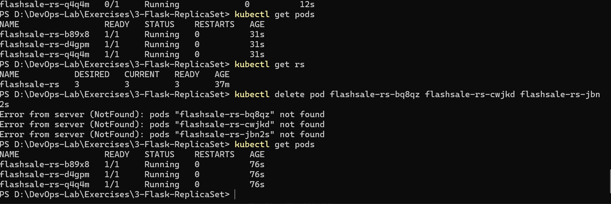
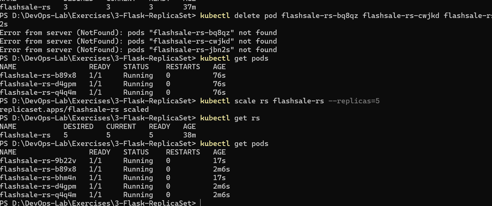
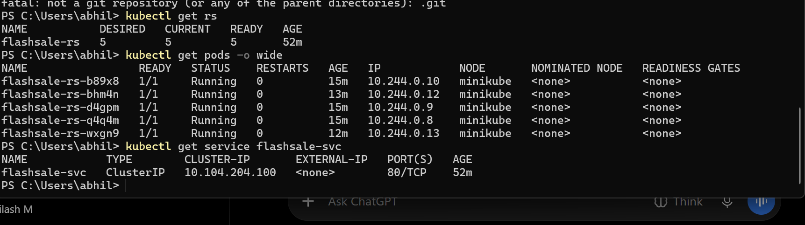

# Exercise 3: Scaling a Flask Application Using Kubernetes ReplicaSets

## Aim
To deploy a Flask application on Kubernetes using a ReplicaSet and demonstrate horizontal scaling by increasing the number of Pod replicas from 3 to 5.

## Technologies Used
- Python
- Flask
- Docker
- Kubernetes
- Minikube
- Docker Hub

## Project Structure

```text
3-Flask-ReplicaSet/
├── app.py
├── Dockerfile
├── flashsale-replicaset.yaml
├── README.md
└── Images/
    ├── 03-replicaset-pods-running.png
    ├── 04-replicaset-scaled-to-5.png
    └── 05-replicaset-pods-and-service.png
```

## Application Overview
The Flask application is containerized using Docker and deployed to Kubernetes. A ReplicaSet named `flashsale-rs` manages the application Pods and ensures that the desired number of replicas are running.

A Kubernetes Service named `flashsale-svc` exposes the application on port `80/TCP`.

## Implementation Steps

### 1. Build the Docker Image
Build the Docker image for the Flask application.

```powershell
docker build -t abhilashmugatha/flashsale:1.0 .
```

### 2. Push the Image to Docker Hub
Upload the image to Docker Hub so that Kubernetes can retrieve it.

```powershell
docker push abhilashmugatha/flashsale:1.0
```

### 3. Deploy the ReplicaSet and Service
Apply the Kubernetes configuration file.

```powershell
kubectl apply -f flashsale-replicaset.yaml
```

### 4. Verify the Initial Deployment
Check the ReplicaSet and its Pods.

```powershell
kubectl get rs
kubectl get pods
```

Initially, the ReplicaSet was configured to maintain **3 replicas**. All three Pods reached the `Running` state and became ready.

### 5. Scale the ReplicaSet
Increase the number of replicas from 3 to 5.

```powershell
kubectl scale rs flashsale-rs --replicas=5
```

Verify the updated replica count.

```powershell
kubectl get rs
kubectl get pods
```

The ReplicaSet successfully scaled to **5 replicas**, with all five Pods in the `Running` state and ready.

### 6. Inspect Pod Details and Service
Display the Pod IP addresses and the nodes on which the Pods are running.

```powershell
kubectl get pods -o wide
```

Inspect the Service.

```powershell
kubectl get service flashsale-svc
```

The Service was available on port `80/TCP`.

## Screenshots

### 1. Initial ReplicaSet Deployment


Shows three running Pods and a ReplicaSet with three ready replicas.

### 2. Scaling to Five Replicas


Shows the scaling command and five running Pods, with five desired, current, and ready replicas.

### 3. Pod Details and Service


Shows the five running Pods, their IP addresses and node information, and the `flashsale-svc` Service.

## Result
The Flask application was deployed successfully on Kubernetes using a ReplicaSet. The ReplicaSet maintained three running Pods initially and was then scaled to five replicas. The final verification confirmed that all five Pods were running and ready, and the Kubernetes Service was available.

## Conclusion
This exercise demonstrated containerizing a Flask application with Docker, deploying it using Kubernetes, managing Pods through a ReplicaSet, and performing horizontal scaling from three to five replicas.
